# Siamese Network for ISIC Melanoma Triage
**Problem:** binary classification of dermoscopic images (benign vs. melanoma) with a confidence indication for  "refer to a specialist" option if unsure.
**Model:** Siamese metric-learning network (shared ResNet-18 encoder, contrastive loss, k-nearest-neighbour inference), compared against a conventional ResNet-18 classifier.
**Dataset:** [ISIC Melanoma Dataset, resized to 224x224 (Kaggle)](https://www.kaggle.com/datasets/roua91/isic-melanoma-dataset-resized-to-224x224) [7].

## Contents

1. [Overview](#1-overview)
2. [Feasibility Review](#2-feasibility-review)
3. [Repository Structure, Dependencies and Usage](#3-repository-structure-dependencies-and-usage)
4. [Data, Pre-processing and Splits](#4-data-pre-processing-and-splits)
5. [Method](#5-method)
6. [Results: Benchmarking Against the Baseline](#6-results-benchmarking-against-the-baseline)
7. [Resource Profiling](#7-resource-profiling)
8. [Failure Case Autopsy](#8-failure-case-autopsy)
9. [Recommendation to the Project Manager](#9-recommendation-to-the-project-manager)
10. [Limitations and Future Work](#10-limitations-and-future-work)
11. [Artificial Intelligence Usage Disclosure](#11-artificial-intelligence-usage-disclosure)
12. [References](#12-references)

---

## 1. Overview

### The problem

Melanoma is the deadliest skin cancer, but it is curable when excised early. A triage clinician who reviews dermoscopic images has to decide quickly which lesions need urgent specialist attention, and benign atypical naevi can look very similar to early melanoma. An automated assistant could take routine cases off the clinician's desk, but only if it knows when it does not know: in screening, a single confidently wrong "benign" on a melanoma is far more damaging than a false alarm. This project investigates the **Confidence and Ambiguity Dilemma** of the task sheet: *does a Siamese network's distance-based confidence track diagnostic correctness better than a conventional CNN's softmax confidence, and can a confidence threshold safely automate the confident cases while referring the ambiguous ones to a human?*

### The algorithm

A **Siamese network** [1] passes two images through the *same* encoder (an ImageNet-pretrained ResNet-18 [2] with a small projection head) and maps each to a 128-dimensional, unit-length embedding. It is trained with **contrastive loss** [3] on image pairs: lesions of the same class are pulled together in the embedding space and lesions of different classes are pushed at least a margin apart. After training, every training image is embedded once to form a **reference bank**. A new image is embedded and compared with its **k nearest reference lesions**; their distance-weighted vote gives the melanoma probability, and the share of the vote for the predicted class is the confidence. Cases whose confidence is below a threshold chosen on validation data are **referred** to a specialist. The nearest reference images double as visual evidence for the clinician. The **baseline** is the same pretrained ResNet-18 trained directly as a two-class classifier with class-weighted cross-entropy and temperature scaling [4], so the comparison isolates metric learning versus direct classification rather than two different architectures.

### What the tool returns

For each image: a benign or melanoma decision, a confidence score, "auto" or "REFER", and (Siamese) the closest training lesions with their labels and distances. Green titles are correct predictions, red are errors.

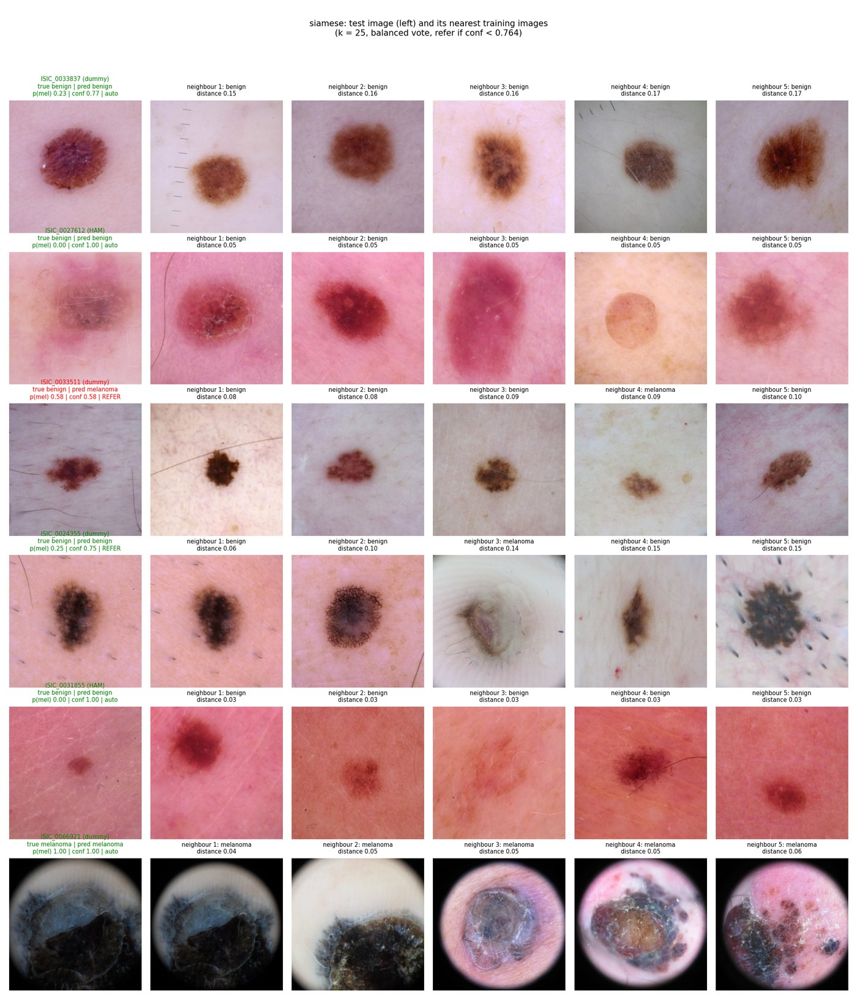

*Figure 1. `python predict.py --model siamese`: six random test images (left column) and their nearest training images. The model's tuned settings (k = 25, class-balanced vote, refer if confidence < 0.764) are shown in the title.*

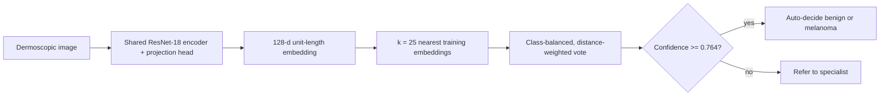

### Headline result

On the held-out test split (3,553 images, 814 melanomas), the Siamese model reaches **0.820 accuracy and 0.909 AUROC**, meeting the task's accuracy target, but the baseline is better on every discrimination and confidence metric (0.838 accuracy, 0.933 AUROC, ECE 0.023 vs 0.065, AURC 0.052 vs 0.062). The Siamese confidence is **not** a better indicator of correctness: 42% of its test predictions have confidence exactly 1.0, and these include confidently missed melanomas. The baseline's reject rule meets the safety target (melanoma recall among auto-decided cases 0.958 with 34% referred); the Siamese rule refers fewer cases (26%) but misses the target (0.921). Both models perform far worse on the realistic `IP` subset of real patients. The recommendation (Section 9) is not to advance the Siamese model as the triage engine.

---

## 2. Feasibility Review

**Project:** Siamese metric-learning classifier with a reject option for melanoma triage
**Dataset:** [ISIC Melanoma Dataset, resized to 224x224 (Kaggle)](https://www.kaggle.com/datasets/roua91/isic-melanoma-dataset-resized-to-224x224)

### 2.1 User Need, Scope and Acceptance Criteria

**Intended user.** A dermatology triage clinician who reviews dermoscopic images and must decide which lesions need urgent specialist attention. The prototype is a decision-support tool.

**Prototype purpose.** Given a dermoscopic image, the system returns (a) a benign/melanoma decision, (b) a confidence score derived from embedding distance, and (c) the nearest reference images as visual evidence. Cases below a validated confidence threshold are referred to a human specialist instead of being auto-decided.

The central question is: *does the Siamese model's distance-based confidence track diagnostic correctness better than a conventional CNN's softmax confidence, and does that justify its extra cost?* A missed melanoma (false negative) is treated as far more costly than a false alarm.

**Scope.**

*In scope:*
- Binary classification (benign vs. melanoma) of single 224x224 dermoscopic images from the Kaggle ISIC dataset, using only the image and its label. Patient metadata such as age, sex and lesion site is not used as a model input.
- A Siamese network (shared ResNet-18 encoder, contrastive loss) and a conventional CNN baseline, trained and evaluated on the same patient-grouped train/validation/test split.
- Distance-based confidence, a reject (refer-to-specialist) rule chosen on validation data, and a calibration and uncertainty comparison against the baseline.
- Profiling of computational cost (parameters, peak GPU memory, inference latency), a failure-case autopsy of 3 to 5 errors, and a written deployment recommendation.

*Out of scope:*
- Clinical validation or regulatory approval. Results are a research prototype on retrospective public data, not evidence of real-world diagnostic safety.
- Multi-class lesion diagnosis (e.g. basal cell carcinoma or keratosis subtypes), lesion segmentation, and full-resolution images.
- Screening-prevalence estimates. The dataset's ~21.5% melanoma rate is artificially high, so precision and positive predictive value will not transfer to a real clinic (<2% malignant).
- Deployment engineering such as a user interface, integration with clinical records, or on-device inference.

**Acceptance criteria.** All are measured on a held-out test split that is only used once, after every choice has been fixed on validation data.

1. **Leakage-free data.** Train, validation and test splits share no `patient_id`. Exact duplicate images, found by file hash, are removed before splitting. Pairs are generated only within a split. The number of images with a true patient ID, a lesion-only ID, or no ID is reported, and the patient-level guarantee is claimed only for the true-patient subset. The split is saved to disk with a fixed seed so it can be reproduced.
2. **Discrimination.** The Siamese model reaches test accuracy of about **0.80**. It also reports per-class precision and recall, macro-F1, AUROC and PR-AUC, compared with the baseline on the same test images.
3. **Confidence.** For both models, report the AUROC of confidence for separating correct from incorrect predictions, the expected calibration error (ECE), and a risk-coverage curve. The baseline is temperature-scaled on validation data so the comparison is fair. The Siamese model passes this criterion if its confidence ranks its own errors at least as well as the calibrated baseline's.
4. **Safe reject rule.** A confidence threshold will be chosen on validation data only, such that **melanoma recall among auto-decided cases is ≥ 0.95**. On test, report the achieved melanoma recall and the **referral rate**, with a provisional target of ≤ 50% of cases referred.
5. **Resource constraint.** All training and evaluation run on a single laptop GPU (Apple M5 Pro, PyTorch MPS backend). Peak training GPU memory is **≤ 8 GiB** at batch size 32, measured by sampling `torch.mps.driver_allocated_memory()` after every training batch. A full training run takes **≤ 2 hours** per model. Per-image inference latency, including the k-nearest-neighbour search for the Siamese model, is **≤ 50 ms**. Parameter count, peak memory and latency are reported for both models, together with the hardware and batch size.

### 2.2 Model Choice and Course Concepts

**Dataset configuration.** According to the Kaggle data card, the dataset [7] merges ISIC 2018, 2019 and 2020 [6]. It contains 24,493 images resized to 224x224: 19,227 benign and 5,266 malignant, about 21.5% malignant after benign undersampling. Labels (`target`), image IDs (`isic_id`) and an optional `patient_id` are in `cleaned_metadata.csv`. The `patient_id` column holds three kinds of identifier (see 2.3): true ISIC 2020 patient IDs (`IP_*`), HAM10000 lesion IDs (`HAM_*`), which identify a lesion rather than a person, and placeholders (`dummy_*`) where no ID exists. This investigation will use a **70/15/15 train/validation/test split, stratified by class and grouped by `patient_id`** (`StratifiedGroupKFold`). Each `HAM_*` and `dummy_*` ID forms its own group. The split is also stratified by ID source (`IP` / `HAM` / `dummy`), because the three sources have very different melanoma rates. Augmentation will include flips, rotations, random resized crops and mild colour jitter, followed by ImageNet normalisation.

**Proposed model.**
- **Encoder:** an ImageNet-pretrained ResNet-18 with its classifier removed. A projection head (512 -> 256 -> 128, ReLU between the layers) produces an L2-normalised 128-dimensional embedding. 
- **Siamese training:** both images in a pair pass through the *same* encoder, which shares its weights. Training uses contrastive loss.
- **Pair generation:** new pairs are sampled every epoch, with equal numbers of same-class and different-class pairs. Malignant anchors are oversampled so the loss is not dominated by benign-benign pairs.
- **Inference:** the *training* split is embedded once to form a reference bank. A query is classified by distance-weighted k-nearest neighbours. Its confidence is the weighted vote fraction for the predicted class. Test images are never used as references.
- **Baseline:** the same pretrained ResNet-18 with a two-class softmax head, trained with class-weighted cross-entropy on the identical split and augmentation. Sharing the backbone isolates the effect of *metric learning versus direct classification* from the effect of the architecture. The baseline is temperature-scaled before the uncertainty comparison.

**Course concepts and literature.** The design draws on convolutional feature extraction and transfer learning [2], metric and contrastive learning [1, 3], handling class imbalance through sampling and class weights, calibration [4] and selective classification [5].

Siamese networks suit this problem because the decision becomes a *comparison against confirmed reference lesions*, which is close to how clinicians reason by example. Distance to those references gives a natural, inspectable signal of ambiguity. Whether that signal is actually better calibrated than softmax confidence is the hypothesis this project tests, not an assumption it makes.

### 2.3 Preliminary Feasibility Evidence

> **Status at the midpoint:** the data audit, the split, smoke tests of both models, peak-memory measurements and one full baseline training run had been completed. All results below were on the validation split; the test split had not been used.

| Check | Result |
|---|---|
| Local size / image format | 399 MB on disk; all 24,493 files are 224x224 JPEGs (6 to 38 KB each) |
| Images found vs metadata rows | 24,493 / 24,493; no missing files, no orphan files, no repeated `isic_id` |
| Class counts | benign 19,227, malignant 5,266 (21.5%); matches the data card |
| `IP_*`: true patient IDs (ISIC 2020) | 11,186 images (45.7%) from 1,919 patients (1 to 43 images each, median 4); 372 patients have both benign and malignant lesions |
| `HAM_*`: HAM10000 lesion IDs, not patient IDs | 2,513 images (10.3%), one image per ID, so grouping by them gives no patient-level protection |
| `dummy_*`: placeholders, no ID | 10,794 images (44.1%), using 10,514 distinct placeholders; 280 placeholders are shared by two images, and 130 of these pair a benign with a malignant image, so they are unlikely to be real patients |
| Exact duplicate images | 0; the 919 `ISIC_*_downsampled` files have no un-suffixed twin |
| Malignant rate by ID source | `dummy`: **37.7%** (4,071 / 10,794); `HAM`: **24.4%** (614 / 2,513); `IP`: **5.2%** (581 / 11,186) |
| Share of all melanomas by ID source | `dummy` 77.3%, `HAM` 11.7%, `IP` 11.0% |
| Melanomas in the older `isic_id` range (< `ISIC_0100000`) | **89.0%** (4,685 / 5,266), versus 45.0% of benign images |
| Patient-grouped split (seed 42, stratified by class x ID source) | train 17,253 (70.4%) / val 3,687 (15.1%) / test 3,553 (14.5%); malignant 21.2% / 21.5% / 22.9%; `IP`/`HAM`/`dummy` 46.0/10.2/43.9% (train), 46.0/10.1/43.9% (val), 43.9/10.9/45.3% (test). Exact balance is limited because `IP` patients (up to 43 images each) cannot be divided between splits. |
| Patient overlap after split | **0** `patient_id`s in more than one split |
| Baseline model | Pretrained ResNet-18 + `Linear(512->2)`: 11,177,538 trainable parameters |
| Siamese model | Same pretrained ResNet-18 + projection head (512->256->128, L2-normalised): 11,340,736 trainable parameters (+1.5%); output shapes, unit-length embeddings, weight sharing and contrastive-loss values checked on synthetic inputs |
| Baseline smoke test (1,000 train / 500 val images, 2 epochs, batch 32, Apple M5 Pro GPU via MPS) | runs end to end; val AUROC 0.873 -> 0.874, val loss 0.523 -> 0.437; about 40 s per epoch; total 1.3 min. Pipeline check only, not a performance result |
| Siamese smoke test (1,000 train pairs / 500 val images, 2 epochs, batch 32, k = 10, margin 1.0, same hardware) | runs end to end; contrastive loss 0.242 -> 0.226 (train), 0.226 -> 0.216 (val); kNN val AUROC 0.865 -> 0.852; about 47 s per epoch, including embedding the reference bank. Pipeline check only |
| Peak training GPU memory (batch 32, MPS, sampled after every batch) | baseline **1.19 GiB**; Siamese **2.20 GiB** (about 1.8x, since each training item is a pair of images). Both well under the 8 GiB limit |
| Baseline full training run (17,253 train / 3,687 val images, lr 1e-4, batch 32, patience 5) | best **val AUROC 0.927** at epoch 4 (val accuracy 0.851); early-stopped after 9 epochs; about 110 s per epoch; 17.1 min in total. Train loss kept falling (0.452 -> 0.318) while val loss rose after epoch 4, so early stopping on val AUROC is needed |

### 2.4 Risks, Budget and Fallback

**Key technical risks.**
1. **Patient leakage.** Only 11,186 images (45.7%, `IP_*`) carry a true patient ID. The other 13,307 have either a lesion ID (`HAM_*`) or no ID (`dummy_*`). The same patient, or the same lesion, may therefore appear in more than one split, or as re-encoded near-duplicates that an MD5 check cannot catch. *Mitigation:* use a `patient_id`-grouped split, so the `IP_*` subset is patient-disjoint and shared placeholders keep their images together. Run a perceptual-hash check for near-duplicates across splits. Claim the patient-level guarantee only for the `IP_*` subset, and state the remaining risk as a limitation.
2. **Source shortcut (confirmed by the audit).** 89% of melanomas lie in the older `isic_id` range. Melanoma rates differ sharply by ID source: 37.7% (`dummy`), 24.4% (`HAM`) and 5.2% (`IP`). The model could partly learn archive-specific appearance (camera, resolution, framing) instead of the pathology. *Mitigation:* stratify the split by class and ID source. Report every metric separately for the `IP`, `HAM` and `dummy` subsets. Check whether high-confidence errors cluster by source in the failure autopsy.
3. **Ineffective pair sampling.** Random pairs are mostly easy, so contrastive loss can plateau. *Mitigation:* oversample malignant anchors, select checkpoints by validation kNN AUROC rather than pair loss, and try triplet loss with batch-hard mining as an ablation.

**Computing budget.**
- Hardware: one Apple M5 Pro laptop GPU (MPS). Neither model needs the Rangpur cluster: the full baseline run took 17 minutes, and the Siamese model is expected to take roughly 3x as long per epoch.
- One smoke test for each model (done).
- About 3 full training runs per model, each ≤ 2 hours with early stopping (patience 3 to 5 epochs).
- One final evaluation on the test set.
- Total ≤ 12 hours of laptop GPU time.

**Fallback.**
- If the Siamese model stays clearly below 0.80 accuracy or AUROC: freeze the early ResNet stages, switch to triplet loss with hard-negative mining, or train a linear head on the frozen Siamese embeddings.
- If memory or runtime limits are exceeded: reduce the batch size or the number of pairs per epoch, use gradient accumulation, freeze the early backbone layers, or move training to the Rangpur cluster.

The split, the metrics and the reject-rule protocol stay fixed throughout, so any fallback can still answer the dilemma. A negative result, such as the Siamese confidence being *no better* than the calibrated baseline, is still a valid, evidence-based recommendation.

---

## 3. Repository Structure, Dependencies and Usage

### 3.1 Files

| File | Purpose |
|---|---|
| [`dataset.py`](dataset.py) | Loads the metadata, removes exact duplicates, builds and saves the patient-grouped split, checks patient overlap and cross-split near-duplicate, defines the augmentations, `LesionDataset` (single images) and `PairDataset` (pairs for contrastive training). |
| [`modules.py`](modules.py) | `BaselineClassifier`, `SiameseNet`, `ContrastiveLoss` and the shared ResNet-18 backbone. Running this alone performs a self-test. |
| [`train.py`](train.py) | Trains either model with early stopping, plots the curves, tunes the post-hoc settings on validation, tests once on the test split and saves every result. |
| [`metrics.py`](metrics.py) | Helper with measurement and plotting functions only: discrimination metrics, ECE, risk-coverage/AURC, single-image latency and the evaluation plots. |
| [`predict.py`](predict.py) | Example usage: loads the saved weights and tuned settings, classifies chosen or random test images, prints the results, draws the figures and runs the failure autopsy. |
| `images/` | Figures used in this README (copied from `outputs/`). |
| `outputs/` | Generated files from the final run: training and prediction logs, tuned settings, JSON/CSV test results and plots. The model weights (`*_best.pt`) and the cached Siamese reference bank (`siamese_bank.pt`) are not committed (`.gitignore`); rerun `train.py` to recreate them. |
| `data/` | The dataset and `splits.csv`. Not committed (`.gitignore`); see Section 3.3. |

### 3.2 Dependencies

Tested with **Python 3.12.1** on macOS with an **Apple M5 Pro** GPU (PyTorch MPS backend). The code also runs on CUDA (e.g. Rangpur) or CPU. This is automatically chosen by `pick_device()` in `train.py`.

| Package | Version |
|---|---|
| torch | 2.8.0 |
| torchvision | 0.23.0 |
| numpy | 2.2.6 |
| pandas | 2.3.2 |
| scikit-learn | 1.7.1 |
| pillow | 11.2.1 |
| matplotlib | 3.10.6 |

```bash
python3.12 -m venv .venv
source .venv/bin/activate
pip install -r requirements.txt
```

### 3.3 Data

Download the [Kaggle dataset](https://www.kaggle.com/datasets/roua91/isic-melanoma-dataset-resized-to-224x224) and place it inside the `data/` folder so that the folder looks like this :

```
data/
  cleaned_metadata.csv
  combined_images/ISIC_0000000.jpg ...
```

### 3.4 Running the pipeline

```bash
python dataset.py  # creates data/splits.csv (seed 42) and prints the data audit
python modules.py  # model self-test: shapes, unit-length embeddings, weight sharing, loss values
python train.py --model baseline # train, tune on validation, test once, save to outputs/
python train.py --model siamese # same for the Siamese network; also draws the joint test plots
python predict.py --model siamese  # 6 random test images with their nearest training images
python predict.py --model baseline --images ISIC_0033837 ISIC_0066921
python predict.py --model siamese --autopsy  # 3 most confident missed melanomas + 2 false alarms
python predict.py --model siamese --show_full_test # saved results on the full test split
```

Useful extra options: `train.py --model siamese --skip_training` re-tunes and re-tests a saved checkpoint, `--test_only` re-tests it with its saved settings, and `--epochs`, `--batch_size`, `--patience`, `--margin`, `--seed` override the defaults.

**Outputs** (all in `outputs/`): `<model>_best.pt` (weights), `<model>_history.json` and `<model>_curves.png` (training), `<model>_tuned.json` (settings chosen on validation), `<model>_test_results.json` (all test metrics, overall and per ID source), `<model>_test_predictions.csv` (one row per test image), `siamese_k_tuning.png`, `roc_pr_curves.png`, `reliability_diagram.png`, `risk_coverage.png`, `siamese_bank.pt` (cached reference bank) and the `predict_*` / `autopsy_*` figures.

### 3.5 Reproducibility

- **Fixed split:** the split is created once with seed 42 and saved to `data/splits.csv`; every script reuses it. Deleting it and re-running `dataset.py` regenerated a byte-for-byte identical file.
- **Seeds:** `torch.manual_seed(0)` for training; pairs are drawn from a per-item seeded generator (`seed, epoch, index`), so they do not depend on the number of DataLoader workers; the random demo images use a fixed seed.
- **Verified:** for the final run, `outputs/` was emptied and the split, both trainings, tuning and testing were run from scratch. The test metrics matched the previous full run to three decimal places for both models. GPU kernels on MPS/CUDA are not guaranteed to be bit-for-bit deterministic, so small differences are possible on other hardware.
- **Checks on the inference path:** `predict.py` reproduces the test-step probabilities for the same images (maximum difference 3e-8), and the cached reference bank is invalidated automatically when the checkpoint changes.

### 3.6 Example input and output

Input: one or more test images (by `isic_id`). Output of `python predict.py --model siamese`:

```text
Running the trained siamese model: k 25, vote balanced, temperature None, reject threshold 0.764

isic_id        source      true      pred  p(mel)  conf decision
ISIC_0033837  dummy    benign    benign   0.230 0.770     auto
nearest training images: ben 0.15, ben 0.16, ben 0.16, ben 0.17, ben 0.17
              
ISIC_0033511  dummy    benign  melanoma   0.583 0.583    REFER
nearest training images: ben 0.08, ben 0.08, ben 0.09, mel 0.09, ben 0.10

ISIC_0066921  dummy  melanoma  melanoma   1.000 1.000     auto
nearest training images: mel 0.04, mel 0.05, mel 0.05, mel 0.05, mel 0.06
figure is stored in outputs/predict_siamese.png
```

The second case shows the reject rule working as intended as the model's vote is split, it would have been wrong, and it is referred. The baseline equivalent (`python predict.py --model baseline`) is shown in Figure 2.

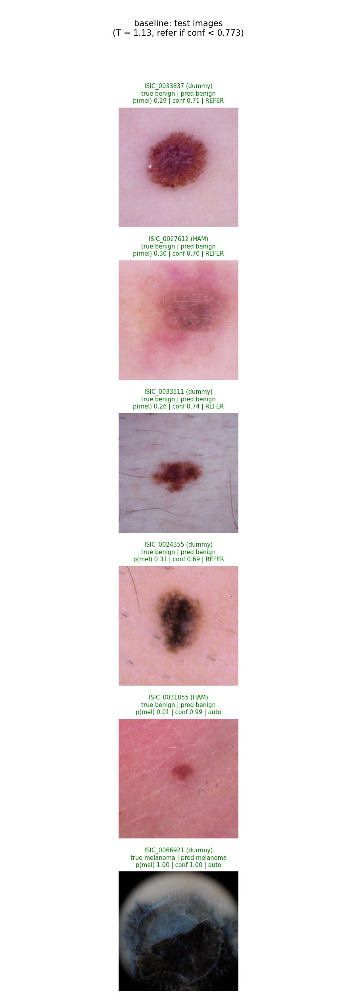

*Figure 2. Baseline on the same six random test images. It refers four of them, all correctly classified but with confidence below its threshold of 0.773.*

---

## 4. Data, Pre-processing and Splits

### 4.1 Data audit (from `python dataset.py`)

| Check | Result |
|---|---|
| Images / metadata rows | 24,493 / 24,493 (19,227 benign, 5,266 melanoma) |
| Exact duplicates (MD5 of file bytes) | **0** removed |
| Patient IDs in more than one split | **0** |
| Near-duplicate images across splits (16x16 difference hash [10]) | **0** groups |

With the common 8x8 difference hash, 37 cross-split groups (101 images) matched. Visual inspection showed these were *different* lesions with the same coarse layout (a small central lesion on plain skin, or the black circle of a dermatoscope), and 15 groups even mixed benign and melanoma images. A 16x16 (256-bit) hash removes these false matches and finds no duplicates, so no near-duplicate leakage was detected.

### 4.2 Pre-processing

The Kaggle images are already resized to 224x224, the input size of ResNet-18, so no resizing is needed at evaluation time.

- **All splits:** conversion to a tensor and normalisation with the ImageNet mean and standard deviation, matching the statistics the pretrained backbone was trained with [2].
- **Training only (augmentation):** random resized crop (scale 0.8 to 1.0, aspect 0.9 to 1.1), horizontal and vertical flips, rotation up to 30 degrees, and mild colour jitter (brightness and contrast 0.2, saturation 0.1, hue 0.02). Dermoscopic lesions have no canonical orientation, so flips and rotations add label-preserving variety; geometric and mild colour augmentation are among the most effective augmentations for skin lesion analysis [11]. Colour jitter is kept mild because colour (blue-white veil, multiple browns) is diagnostically meaningful for melanoma.
- **No hair removal, cropping of the dermatoscope frame or colour constancy** were applied, so that the failure autopsy could test whether the models rely on such artefacts (Section 8).

### 4.3 Training, validation and test splits

| Split | Images | Melanoma rate | ID groups | IP / HAM / dummy |
|---|---|---|---|---|
| Train | 17,253 (70.4%) | 21.2% | 10,463 | 46.0 / 10.2 / 43.9% |
| Validation | 3,687 (15.1%) | 21.5% | 2,240 | 46.0 / 10.1 / 43.9% |
| Test | 3,553 (14.5%) | 22.9% (814) | 2,243 | 43.9 / 10.9 / 45.3% |

**Justification.**
- **Grouped by `patient_id`.** The split uses `StratifiedGroupKFold` with 20 folds, of which 14 form the training set, 3 the validation set and 3 the test set, and every image that shares a `patient_id` is kept in the same fold. This matters because a single `IP` patient can contribute up to 43 images. This is because if those images were spread across splits, the model could learn to recognise the patient's skin, lighting or camera instead of the lesion itself, and the test scores would be inflated by images it had effectively already seen. Grouping therefore makes the true-patient (`IP`) subset strictly patient-disjoint. The same guarantee cannot be given for the `HAM` and `dummy` images, because their identifiers describe a lesion or a placeholder rather than a person, so it is claimed only for the `IP` subset and the remaining risk is stated as a limitation.
- **Stratified by class x ID source** (six strata). The sources have very different melanoma rates (5.2%, 24.4%, 37.7%), so an unstratified split could give the test set a different source mix and change every metric for reasons unrelated to the model.
- **Different roles for each split.** Training data fits the weights where as validation data is used for everything that is *chosen* such as the best epoch (early stopping on validation AUROC), the baseline temperature, the Siamese k and vote, and the reject threshold. The test split is used only to measure the final, frozen models. This is because tuning on the training set instead would give overconfident settings, because the model has already fit those images.
- **15% for testing** gives 814 test melanomas, enough for a 95% confidence interval of about plus or minus 2 to 3 points on the reject rule's recall, which is the quantity the safety criterion depends on.
- **Pairs are generated within one split only**, and the kNN reference bank contains training images only, so no test image is ever used as a reference.

---

## 5. Method

### 5.1 Models

| | Baseline | Siamese |
|---|---|---|
| Backbone | ImageNet-pretrained ResNet-18, final layer removed (512 features) | same |
| Head | `Linear(512 -> 2)` | `Linear(512 -> 256) -> ReLU -> Linear(256 -> 128)`, L2-normalised |
| Training input | single images | image pairs, both through the same weights |
| Loss | cross-entropy with inverse-frequency class weights [0.63, 2.36] | contrastive loss, margin 1.0 |
| Prediction | softmax of logits / T | distance-weighted kNN vote over the training bank |
| Trainable parameters | 11,177,538 | 11,340,736 |

**Pair sampling for Siamese.** Each epoch draws 17,253 fresh pairs. Each pair first picks the anchor class with probability 0.5, then a same-class or different-class partner with probability 0.5, so the four pair types (melanoma-melanoma, melanoma-benign, benign-benign, benign-melanoma) each make up about 25% of an epoch. This oversamples melanoma anchors (21% of images, 50% of anchors) and balances the loss.

**Contrastive loss** [3] for a pair with embedding distance d and label s (1 = same class):

L = s * d^2 + (1 - s) * max(0, m - d)^2, with margin m = 1.0, averaged over the batch.

Embeddings have length 1, so distances lie in [0, 2] and the margin of 1.0 is meaningful across images.

**Training.** AdamW, learning rate 1e-4, batch size 32, up to 20 epochs, early stopping when the validation AUROC has not improved for 5 epochs; the checkpoint with the best validation AUROC is kept. For the Siamese model, validation AUROC is computed by embedding the training bank and classifying validation images with a 5-nearest-neighbour vote, i.e. the way the model is used, rather than from the pair loss.

### 5.2 Confidence, calibration and the reject rule

- **Melanoma probability p.** Baseline: softmax of the logits divided by a temperature T. Siamese: among the k nearest training embeddings, each neighbour votes with weight 1/distance; p is the weighted share of melanoma votes.
- **Class-balanced vote.** The training bank is 79% benign, so in a plain vote an ambiguous lesion is surrounded mostly by benign neighbours simply because there are more of them. Optionally, each melanoma neighbour's vote is multiplied by n_benign / n_melanoma = 3.71, the kNN analogue of the baseline's class-weighted loss.
- **Confidence** is the probability of the predicted class, max(p, 1 - p), in [0.5, 1]; the decision threshold for the class is 0.5.
- **Temperature scaling** [4]: T is fitted on validation logits by minimising the negative log-likelihood (LBFGS on log T). It is applied to the baseline only; the Siamese vote has no logits, and with two classes a monotone rescaling cannot change the ranking of its confidences anyway.
- **Reject rule.** Auto-decide a case if its confidence is at least t, otherwise refer it. t is the *smallest* threshold for which melanoma recall among the auto-decided validation cases is at least 0.95, i.e. the one that automates the most cases while meeting the safety target. If no threshold reaches the target, every case is referred.

### 5.3 What is tuned on validation, and how

| Setting | Model | Candidates | Selection rule (validation only) | Chosen |
|---|---|---|---|---|
| Best epoch | both | every epoch | highest validation AUROC | baseline epoch 7, Siamese epoch 2 |
| Temperature T | baseline | continuous | minimum negative log-likelihood | 1.126 |
| k and vote | Siamese | k in {3, 5, 10, 15, 20, 25, 30, 50, 75, 100, 150, 200} x {plain, balanced} | lowest referral rate that meets the 95% recall target, ties broken by AURC | k = 25, balanced |
| Reject threshold t | both | every distinct confidence | smallest t with auto-decided melanoma recall ≥ 0.95 | baseline 0.773, Siamese 0.764 |

The k and vote are chosen by the operational goal (refer as few cases as possible while staying safe) rather than by AURC. AURC alone would always pick the plain vote, which can never meet the recall target (Figure 3).

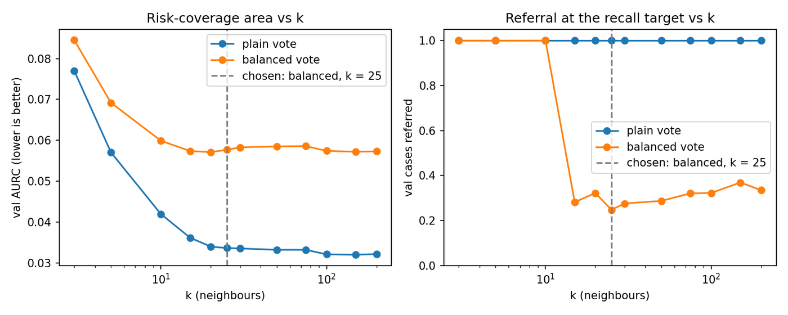

*Figure 3. Siamese tuning on validation. Left: AURC (lower is better). Right: share of cases referred at the 95% recall target. The plain vote ranks errors better (lower AURC) but has to refer every case at every k; the balanced vote makes automation possible from k = 15 upwards.*

| Vote | k | Val AURC | Val AUROC | Val melanoma recall | Val referred |
|---|---|---|---|---|---|
| plain | 5 (training) | 0.057 | 0.895 | 0.704 | 100% |
| plain | 150 (best AURC) | 0.032 | 0.919 | 0.679 | 100% |
| balanced | 15 | 0.057 | 0.916 | 0.876 | 28.2% |
| **balanced** | **25 (chosen)** | **0.058** | **0.919** | **0.880** | **24.8%** |
| balanced | 100 | 0.057 | 0.919 | 0.880 | 32.2% |

The vote weight changes p monotonically, so it never changes AUROC; it moves cases across the 0.5 decision boundary, which raises melanoma recall from about 0.70 to 0.88 at the cost of more false alarms (hence the higher AURC).

### 5.4 Metrics

- **Discrimination:** accuracy, per-class precision and recall, macro-F1, AUROC, PR-AUC (average precision) and the confusion matrix, overall and per ID source.
- **Confidence:** AUROC of confidence for separating correct from wrong predictions; expected calibration error with 15 bins [4, 9]; risk-coverage curve and its area AURC [5]. In AURC, tied confidences are given the error rate of their whole tied group, because no threshold can split a tie; this matters for the Siamese model, which has many cases at exactly 1.0.
- **Reject rule:** referral rate, melanoma recall and accuracy among auto-decided cases, melanomas missed by automation, and system sensitivity if every referred case is diagnosed correctly by the specialist.
- **Resources:** trainable parameters, peak training GPU memory, training time and median single-image latency (batch size 1, after warm-up, including the kNN search over all 17,253 bank embeddings).

---

## 6. Results: Benchmarking Against the Baseline

All numbers are on the same held-out test split of **3,553 images (814 melanomas)**, with every setting frozen beforehand on validation.

### 6.1 Training curves

| 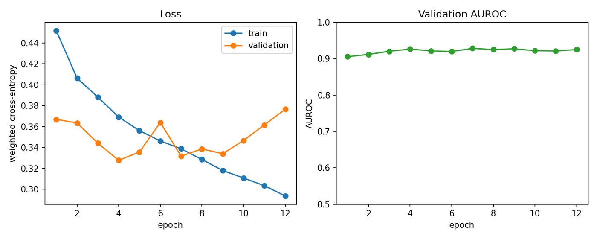 | 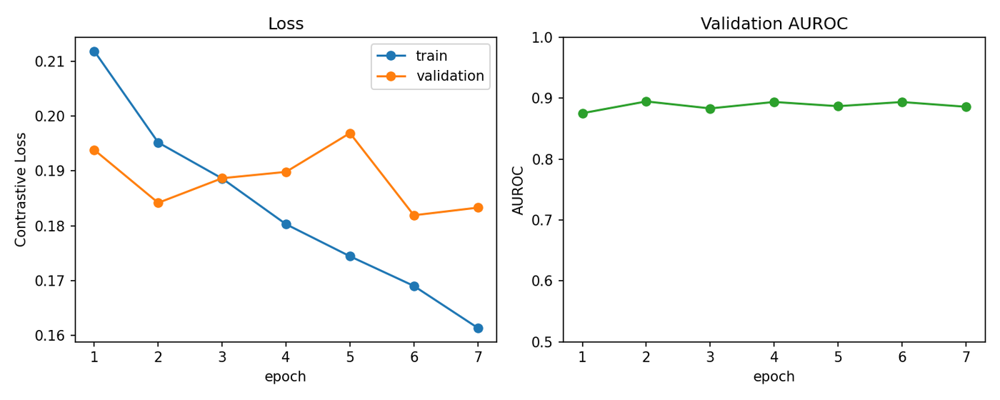 |
|---|---|
| *Baseline: weighted cross-entropy and validation AUROC. Best validation AUROC 0.928 at epoch 7; early-stopped after 12 epochs.* | *Siamese: contrastive loss and validation kNN AUROC (k = 5). Best 0.895 at epoch 2; early-stopped after 7 epochs.* |

In both models the training loss keeps falling while the validation loss stops improving after a few epochs, so early stopping on validation AUROC is needed. The Siamese validation AUROC plateaus early: after epoch 2 the encoder separates the training pairs better (pair loss 0.195 to 0.161) without improving the neighbourhoods of validation images.

### 6.2 Discrimination

| Metric (test) | Baseline | Siamese |
|---|---|---|
| Accuracy | **0.838** | 0.820 |
| AUROC | **0.933** | 0.909 |
| PR-AUC | **0.829** | 0.781 |
| Macro-F1 | **0.799** | 0.779 |
| Precision / recall: benign | 0.954 / **0.830** | 0.946 / 0.813 |
| Precision / recall: melanoma | **0.602** / **0.866** | 0.573 / 0.845 |
| Confusion matrix [[TN, FP], [FN, TP]] | [[2273, 466], [109, 705]] | [[2226, 513], [126, 688]] |

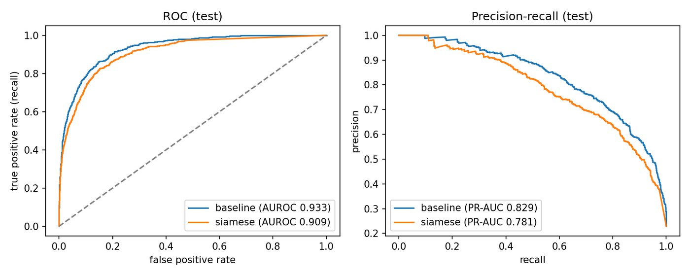

*Figure 4. ROC and precision-recall curves on the test split. The baseline dominates at almost every operating point.*

### 6.3 Confidence and calibration

| Metric (test) | Baseline (T = 1.126) | Siamese (k = 25, balanced) |
|---|---|---|
| Confidence AUROC (correct vs wrong), higher is better | **0.810** | 0.803 |
| ECE, lower is better | **0.023** | 0.065 |
| AURC, lower is better | **0.052** | 0.062 |
| Test cases with confidence exactly 1.0 | 0% | **42.3%** |
| Errors among cases with confidence ≥ 0.99 | 1 of 402 | **21 of 1,512** |

| 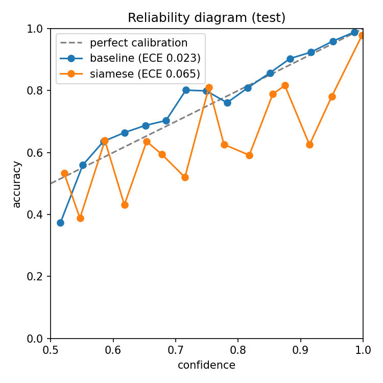 | 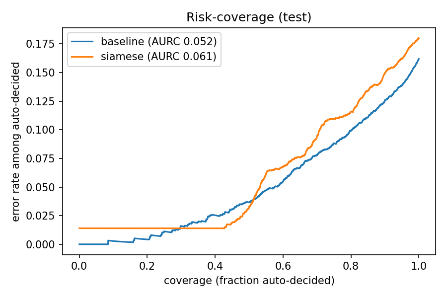 |
|---|---|
| *Figure 5. Reliability diagram. The baseline follows the diagonal; the Siamese vote is irregular and mostly overconfident.* | *Figure 6. Risk-coverage. The Siamese curve starts at about 1.4% error rather than 0: its most confident block of tied cases already contains errors.* |

The Siamese confidence ranks its own errors about as well as the baseline's by confidence AUROC (0.803 vs 0.810) but worse by AURC. However, it is not accurate as it is certain (confidence 1.0, all 25 neighbours of one class) on 42% of test images, and among the 1,512 cases with confidence of at least 0.99 it is wrong 21 times, including missed melanomas, representing the "stubbornly overconfident" behaviour revealed in the dilemma. Once all k neighbours share a class, the vote is exactly 1.0 however far away those neighbours are, so nothing in the model expresses doubt for an image that falls inside a single-class cluster. This could be due to several limitations such as low ratio 

Temperature scaling barely changed the baseline (T = 1.126; validation ECE 0.026 before and 0.027 after). Class-weighted training with early stopping had already left the baseline well calibrated, and temperature scaling minimises log-loss rather than ECE, so a tiny ECE change in either direction is expected.

### 6.4 Reject rule

| Test | Baseline | Siamese |
|---|---|---|
| Threshold | 0.773 | 0.764 |
| Cases referred | 34.3% | **25.6%** |
| Accuracy of auto-decided cases | **0.931** | 0.891 |
| Melanoma recall among auto-decided (target ≥ 0.95) | **0.958** (531 / 554; 95% CI 0.938 to 0.972) | 0.921 (563 / 611; 95% CI 0.897 to 0.940) |
| Melanomas missed by automation | **23** | 48 |
| System sensitivity (referred cases diagnosed correctly) | **0.972** | 0.941 |

On validation both rules met the target by construction (0.951 for each). On test the baseline's rule held (0.958) while the Siamese rule fell to 0.921, and its confidence interval excludes 0.95, so this is a real shortfall rather than noise. The Siamese threshold sits next to a large tied block of confidences near 1.0 and k was chosen as the single lowest-referral point of a noisy validation curve (Figure 3); both make its validation estimate optimistic.

### 6.5 Results per ID source

| Source (test images, melanomas) | Model | Accuracy | AUROC | PR-AUC | Melanoma recall | Referred | Auto-decided melanoma recall | Melanomas missed by automation |
|---|---|---|---|---|---|---|---|---|
| IP (1,558, 92) | Baseline | 0.919 | 0.882 | 0.413 | 0.554 | 22.8% | **0.558** | 19 |
| | Siamese | 0.900 | 0.841 | 0.351 | 0.511 | 17.8% | **0.569** | 22 |
| HAM (386, 88) | Baseline | 0.858 | 0.942 | 0.838 | 0.830 | 29.3% | 0.982 | 1 |
| | Siamese | 0.837 | 0.922 | 0.759 | 0.807 | 23.8% | 0.933 | 4 |
| dummy (1,609, 634) | Baseline | 0.755 | 0.906 | 0.873 | 0.916 | 46.5% | 0.993 | 3 |
| | Siamese | 0.739 | 0.874 | 0.833 | 0.899 | 33.4% | 0.956 | 22 |

The sources differ so much in melanoma rate that each needs its own reference point before the numbers can be compared:

| Source | Melanoma rate (test) | Accuracy of always predicting "benign" | PR-AUC of a random classifier | Melanomas in the training split |
|---|---|---|---|---|
| IP | 5.9% | **0.941** | 0.059 | 421 (11%) |
| HAM | 22.8% | 0.772 | 0.228 | 425 (12%) |
| dummy | 39.4% | 0.606 | 0.394 | 2,815 (77%) |

`IP` has the highest accuracy, yet both models score *below* the trivial "always benign" rule on it (0.919 and 0.900 against 0.941), because 94% of `IP` images are benign. On `HAM` and `dummy` the models clearly beat that rule. However, prevalence-independent and prevalence-adjusted metrics depicts AUROC is lowest on `IP` (0.882 / 0.841), and its PR-AUC of 0.413 is about 7 times chance but still means most melanoma alarms on `IP` are false.

Melanoma recall is about 0.90 on `dummy` but only 0.51 to 0.55 on `IP` where roughly every second real-patient melanoma is called benign. Three causes are visible in the data i.e. 77% of the training melanomas come from `dummy`, so the models mostly learned what a melanoma looks like in the older archives; those archives carry acquisition cues such as the black dermatoscope circle that correlate with the label (Section 8); and `IP` melanomas come from screening and are often small, early and subtle, the benign mimicry the task describes.

Moreover, the reject rule is uncertain in the wrong places as it refers the most cases where the models are already safe (for example: `dummy`, 46.5% referred, auto-decided recall 0.993 for the baseline) and the fewest where they are dangerous (`IP`, 22.8% referred, auto-decided recall 0.558). Most `IP` images look typically benign, so the models are confident on them, including on the `IP` melanomas they miss: confidence tracks how typical an image looks, not how likely the prediction is to be wrong. As a result the automation silently misses 19 of 92 `IP` melanomas (baseline) or 22 of 92 (Siamese), compared with 3 of 634 `dummy` melanomas for the baseline. The auto-decided `IP` estimates rest on only 43 to 51 melanomas (95% interval roughly 0.41 to 0.70), but even the upper end is far below the 0.95 target.

**The pooled result is a `dummy` result.** 78% of the test melanomas are `dummy` (634 of 814), so the pooled auto-decided recall of 0.958 for the baseline is dominated by that source, while the `IP` melanomas (11%) barely move it. The pooled 95% target is met by the population mix, not by the model being safe on every kind of patient. In a clinic whose patients resemble `IP`, at an even lower melanoma rate, the target would fail for both models.

**Overall: Baseline vs Siamese.** 
The baseline is better on every source for AUROC, PR-AUC and melanoma recall. The Siamese model refers fewer cases on every source, but pays for it in misses, most visibly on `dummy` (22 missed melanomas against 3): these are its confidence-1.0 errors, where all 25 neighbours sit in a tight cluster of the other class. On `IP` both models are equally poor, so the real-patient problem comes from the data rather than the architecture. This motivates the per-source thresholds and shortcut removal recommended in Section 9.

### 6.6 Acceptance criteria

This table compares the test results with the five acceptance criteria set before training in Section 2.1. Each verdict uses the held-out test split, which was evaluated only once, after the epoch, temperature, k, vote and reject threshold had all been fixed on validation data.

| Criterion | Target | Result | Verdict |
|---|---|---|---|
| 1. Leakage-free data | no shared patient IDs; duplicates removed; reproducible split | 0 patient overlap, 0 exact duplicates, 0 near-duplicates across splits, pairs within one split, split saved and regenerated identically; patient guarantee claimed for `IP` only | **Met** |
| 2. Discrimination | Siamese test accuracy about 0.80, all metrics reported vs baseline | 0.820 accuracy, 0.909 AUROC; all metrics reported; below the baseline on every metric | **Met** (but worse than baseline) |
| 3. Confidence | Siamese ranks its errors at least as well as the calibrated baseline | confidence AUROC 0.803 vs 0.810; AURC 0.062 vs 0.052; ECE 0.065 vs 0.023 | **Not met** |
| 4. Safe reject rule | auto-decided melanoma recall ≥ 0.95 with ≤ 50% referred | Siamese 0.921 at 25.6% referred; baseline 0.958 at 34.3% | **Not met by Siamese** (met by baseline) |
| 5. Resources | ≤ 8 GiB, ≤ 2 h per model, ≤ 50 ms per image | 2.24 GiB, 22.6 min, 3.8 ms (Siamese) | **Met** |

Criteria 3 was not met because the Siamese confidence is a weighted vote of the 25 nearest training images, not a learned probability. When all 25 neighbours share a class, the vote is exactly 1.0 however far away they are, so 42.3% of test images get confidence 1.0 and the model cannot rank errors inside that tied block (21 errors among its 1,512 cases at confidence ≥ 0.99, against 1 of 402 for the baseline). The vote also had no calibration step equivalent to the baseline's temperature scaling, which explains the higher ECE (0.065 vs 0.023). 

Criteria 3 was not met because the threshold was chosen to give exactly 0.95 recall on validation, so it had no safety margin, and the Siamese validation estimate was optimistic for two reasons. First, the threshold sits next to the large tied block of confidences near 1.0, so a small shift in where test images fall moves many cases across it. Second, k was chosen as the single lowest-referral point of a noisy validation curve (Figure 3). No threshold below 1.0 can catch the confident misses and a melanoma surrounded by 25 benign neighbours scores 1.0 and is always auto-decided. On test the Siamese rule missed 48 melanomas, and its 95% confidence interval (0.897 to 0.940) excludes 0.95, so the shortfall is real rather than noise. The baseline met the target with the same procedure because its confidences are continuous and better ranked, at the cost of referring more cases (34.3% vs 25.6%).

---

## 7. Resource Profiling

Apple M5 Pro laptop GPU (PyTorch 2.8.0, MPS backend), batch size 32, 4 DataLoader workers.

| | Baseline | Siamese | Siamese / baseline |
|---|---|---|---|
| Trainable parameters | 11,177,538 | 11,340,736 | 1.01x |
| Peak training GPU memory | 1.23 GiB | 2.24 GiB | 1.8x |
| Time per epoch | 110 s | 193 s | 1.75x |
| Epochs until early stopping | 12 | 7 | |
| Total training time | 22 min of compute (29.6 min wall clock, including one 7.5-minute pause while the laptop slept during epoch 8) | 22.6 min | |
| Median single-image latency (batch 1) | 3.0 ms | 3.8 ms (incl. kNN search over 17,253 embeddings) | 1.3x |
| Extra inference storage | none | reference bank: 17,253 x 128 floats (about 9 MB) | |

Both models fit comfortably on a laptop. The Siamese model costs almost twice the training memory and time per epoch (every item is a pair of images), needs a reference bank that grows with the training set, and its latency depends on the bank size, although at this scale it stays two orders of magnitude below the 50 ms limit.

---

## 8. Failure Case Autopsy

The failure cases are the **most confident errors** on the test split (the dangerous ones: the model was sure, wrong and auto-decided), chosen automatically by `python predict.py --autopsy` from the saved test predictions: the three most confident missed melanomas and the two most confident false alarms.

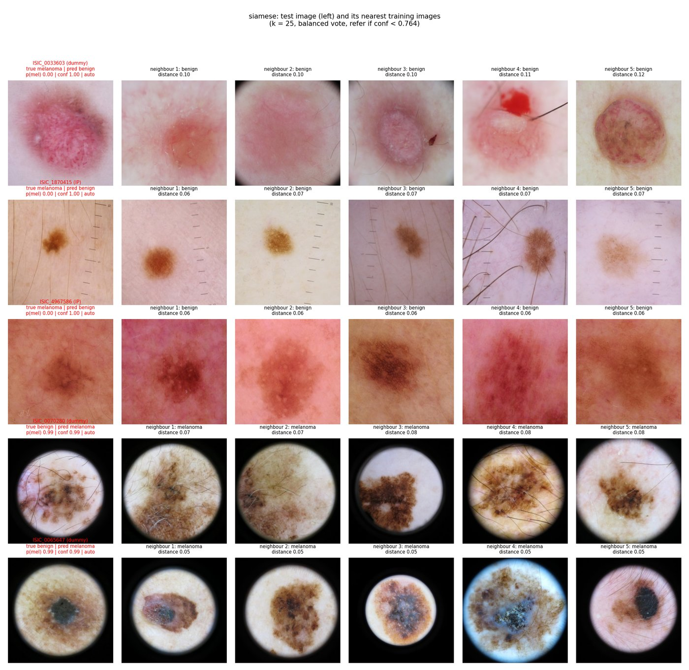

*Figure 7. Siamese autopsy: each failure (left) with its five nearest training images. All five were auto-decided.*

| # | Case | Truth / prediction | Confidence | What the evidence shows | Failure trigger |
|---|---|---|---|---|---|
| 1 | ISIC_1870415 (IP) | melanoma / benign | 1.00, auto | A small brown lesion next to a **ruler scale**. All five nearest training images are benign lesions photographed with the same ruler and framing. | **Acquisition artefact shortcut:** the embedding matches the imaging setup (ruler, framing, small central lesion) rather than the lesion's structure. |
| 2 | ISIC_4967586 (IP) | melanoma / benign | 1.00, auto | A large, ill-defined, light-brown lesion filling the frame; neighbours are diffuse benign naevi with a similar reticular pattern. | **Genuine mimicry** between an early melanoma and an atypical naevus, the ambiguous case the triage system exists for; the model shows it as certain because all 25 neighbours are benign. |
| 3 | ISIC_0033603 (dummy) | melanoma / benign | 1.00, auto | A pink-red, vascular lesion with little pigment; neighbours are pink benign lesions (one with blood and a hair). | **Hypo-pigmented (amelanotic-looking) melanoma:** the learned similarity is driven by colour, and pink melanomas are rare in the bank, so the nearest references are benign. |
| 4 | ISIC_0070280 (dummy) | benign / melanoma | 0.99, auto | Pigmented lesion inside the **black circular dermatoscope frame**; all five neighbours are melanomas with the same frame. | **Source shortcut:** the framed `dummy` images are 38% melanoma, and the embedding clusters by frame, as predicted by Risk 2 of the feasibility review. |
| 5 | ISIC_0065647 (dummy) | benign / melanoma | 0.99, auto | Benign lesion with a dark blue-grey centre, again inside the circular frame; neighbours are framed melanomas with blue-white structures. | **Shortcut plus melanoma-like colour:** blue-grey colour and the frame together outweigh the lesion's benign structure. |

**The baseline fails on different images for related reasons** (Figure 8, all `IP` cases): two of its three most confident missed melanomas are almost hidden behind **dense hair**, the third is a faint, low-contrast pigmented lesion, and its false alarms are a benign lesion with a strongly **vascular, reticular** pattern and a pigmented lesion beside a **ruler**. Hair and rulers are the artefacts named in the task sheet.

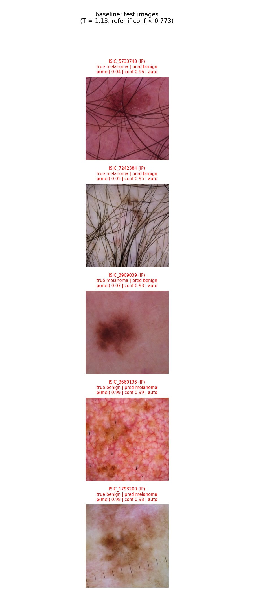

*Figure 8. Baseline autopsy (`python predict.py --model baseline --autopsy`).*

**Where errors cluster** (`--autopsy` also prints this table; wrong but auto-decided = errors the reject rule let through):

| Source | Siamese error rate | Siamese wrong but auto-decided | Baseline error rate | Baseline wrong but auto-decided |
|---|---|---|---|---|
| IP | 0.100 | 63 | 0.081 | 39 |
| HAM | 0.163 | 24 | 0.142 | 14 |
| dummy | 0.261 | 202 | 0.245 | 109 |

**Diagnosis.** (1) Both models partly rely on acquisition cues (dermatoscope frame, ruler, hair) that correlate with the source and therefore with the label in this merged dataset. (2) The Siamese model makes this visible, because its "evidence" images share the artefact rather than the pathology, but it also makes it worse: a kNN vote over a cluster of look-alike images produces confidence 1.0, so these errors are auto-decided instead of referred. (3) On real-patient (`IP`) images both models are weak on melanoma, and the reject rule does not protect these patients.

---

## 9. Recommendation to the Project Manager

**Do not advance the Siamese model as the triage engine.**

| Question | Evidence | Answer |
|---|---|---|
| Is the Siamese confidence a better signal of correctness? | Confidence AUROC 0.803 vs 0.810, AURC 0.062 vs 0.052, ECE 0.065 vs 0.023; 21 errors at confidence ≥ 0.99 vs 1 | **No.** It is as good or worse, and overconfident on 42% of cases. |
| Can it safely automate the confident cases? | Recall among auto-decided 0.921 (target 0.95), 48 melanomas missed by automation vs 23 | **No**, not to the agreed safety target. |
| Does it justify its extra cost? | 1.8x training memory, 1.75x time per epoch, a growing reference bank; lower accuracy, AUROC and PR-AUC | **No.** |
| Does the simpler baseline solve the problem? | Pooled target met (0.958 at 34% referred), but auto-decided melanoma recall only 0.56 on `IP` patients | **Not yet.** It passes on paper because of the population mix, not on the patients that matter. |

**Recommended next steps, in order:**
1. **Use the calibrated baseline with its reject rule as the reference design**, for a further retrospective study only, not for clinical use.
2. **Set the referral threshold per population.** Re-fit it on validation data that matches the target clinic (ISIC 2020-like, < 2% melanoma), or require the 95% recall target separately for each image source. On `IP` images the current threshold is far from safe.
3. **Remove acquisition shortcuts** before any further model comparison: crop or mask the dermatoscope frame, apply hair removal, and evaluate on a single acquisition source.
4. **Keep the Siamese nearest-neighbour view as an audit and explanation tool.** Showing the closest reference lesions exposed the ruler and frame shortcuts at a glance (Figure 7). That is valuable for model auditing and clinician trust even though the kNN vote should not make the decision.
5. If metric learning is revisited, try hard-negative mining (triplet loss) and a confidence that also uses absolute distance to the neighbours, so that a query far from every reference is referred instead of being called certain.

**Trade-off summary.** The Siamese design buys interpretability (visible evidence) at the price of worse discrimination, worse calibration, a higher miss rate under automation and about twice the training cost. For a safety-critical triage task, the cheaper calibrated classifier is the better operational choice, and the remaining risk is not the architecture but the dataset's source shortcuts and the low recall on real-patient images.

---

## 10. Limitations and Future Work

- **Not enough melanoma examples.** The training split has about 3.7 benign images for every melanoma, and most of its melanomas come from the `dummy` archive source (2,815 of 3,661) and only 421 come from real patients (`IP`). Class weights and the balanced vote rebalance the decision, but they cannot add variety: the model sees few distinct melanomas from real patients, so its melanoma neighbourhoods in the embedding space are sparse and dominated by one source. This is the most likely cause of the low `IP` melanoma recall (Section 6.5) and of the confident misses behind criteria 3 and 4. More real-patient melanomas, for example from ISIC 2019 or 2020, would address it more directly than further tuning.
- **Patient-level separation is guaranteed only for `IP` images.** `HAM` and `dummy` images have no patient ID; the near-duplicate check found no copies across splits, but different photographs of the same patient could still be split apart.
- **Prevalence.** The dataset is 21.5% melanoma; real screening is below 2%. Precision, PR-AUC and the referral rate will change in a clinic, and the threshold must be re-fitted there.
- **Single training run per model** (one seed, one learning rate, margin 1.0). The rerun reproduced the same numbers, but no variance across seeds or hyperparameters was measured.
- **The confidence measure for the Siamese model** uses only the vote share among neighbours, not how far away they are; a distance-aware confidence is a natural next step.
- **Future work:** hair and frame removal, per-source or prevalence-adjusted thresholds, triplet loss with hard-negative mining, distance-aware confidence, and repeated runs with different seeds.


## 12. References

[1] G. Koch, R. Zemel, and R. Salakhutdinov, "Siamese neural networks for one-shot image recognition," in *ICML Deep Learning Workshop*, 2015.
[2] K. He, X. Zhang, S. Ren, and J. Sun, "Deep residual learning for image recognition," in *Proc. CVPR*, 2016.
[3] R. Hadsell, S. Chopra, and Y. LeCun, "Dimensionality reduction by learning an invariant mapping," in *Proc. CVPR*, 2006.
[4] C. Guo, G. Pleiss, Y. Sun, and K. Q. Weinberger, "On calibration of modern neural networks," in *Proc. ICML*, 2017.
[5] Y. Geifman and R. El-Yaniv, "Selective classification for deep neural networks," in *Proc. NeurIPS*, 2017.
[6] V. Rotemberg *et al.*, "A patient-centric dataset of images and metadata for identifying melanomas using clinical context," *Scientific Data*, vol. 8, 2021.
[7] Kaggle, "ISIC Melanoma Dataset (resized to 224x224)," roua91. CC BY-NC 4.0.
[8] H. Sulakhe, "siamesenetworks-pytorch: loss.py," GitHub repository. [Online]. Available: https://github.com/HarshSulakhe/siamesenetworks-pytorch/blob/master/loss.py (accessed Oct. 21, 2026). Basis of the contrastive loss implementation.
[9] "Expected calibration error explained," jev wiki, GitHub. [Online]. Available: https://github.com/feder-cr/jev/wiki/expected-calibration-error-explained
[10] N. Krawetz, "Kind of like that," *The Hacker Factor Blog*, 2013. Difference hash used for the near-duplicate check.
[11] F. Perez, C. Vasconcelos, S. Avila, and E. Valle, "Data augmentation for skin lesion analysis," in *ISIC Skin Image Analysis Workshop, MICCAI*, 2018.
## AI Declaration

AI tools were used to support specific aspects of the development and testing of this project:

1. **Testing:** I used AI to understand how to verify that the models were functioning as intended before proceeding with training and evaluation. As I was unsure how to test the models using mock data, AI suggested adding particular print statements at the end of `modules.py` to inspect the outputs and confirm that the models were working as expected. I have used those statements in the main() function.

2. **Code structure and implementation planning:** I used AI to discuss and refine my proposed implementation plan after `train.py`. AI suggested separating testing and validation into functionality into an additional `evaluate.py` file and recommended potential evaluation techniques, including temperature scaling and AUROC. However, the suggested structure did not align with my intended design, so I independently refactored the codebase to reflect my own understanding and preferred architecture.

3. **KNN performance improvement:** During the autopsy stage, I identified that the KNN model had low confidence when predicting the benign class, which I attributed to the class imbalance in the training data. I provided AI with the relevant context and described the issue. AI suggested an example approach to address the problem, which I adapted and incorporated into my training implementation.

4. **Autopsy design:** I used AI to explore ideas for the autopsy component and to obtain initial pseudocode. I used these suggestions as a starting point when developing my implementation.

